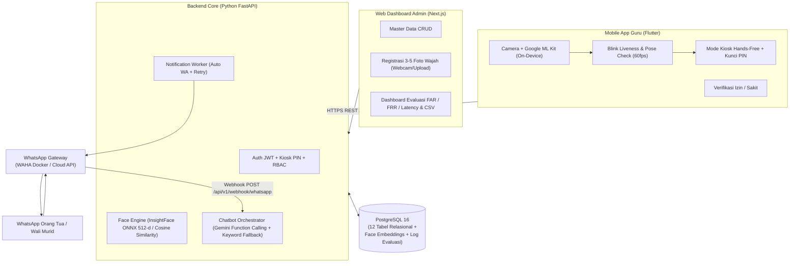

# SmartSchool AI — Aplikasi Absensi Sekolah Cerdas Berbasis Face Recognition & AI Chatbot WhatsApp


**SmartSchool AI** adalah sistem absensi sekolah cerdas *end-to-end* yang menggabungkan **pengenalan wajah otomatis (*Face Recognition*)**, **deteksi keaktifan anti-pemalsuan (*Blink Liveness Detection*)**, dan **Asisten Virtual AI Chatbot di WhatsApp** untuk orang tua/wali murid.

---

## Mengapa Aplikasi Ini Dibuat?

Pencatatan kehadiran di sekolah umumnya masih menggunakan lembar tanda tangan manual atau kartu pelajar fisik yang menyita waktu pelajaran, rentan tertinggal/hilang, serta mudah disalahgunakan (*titip absen*). Selain itu, orang tua sering kali baru mengetahui ketidakhadiran anaknya di akhir pekan atau akhir semester.

**SmartSchool AI** menyelesaikan masalah tersebut dengan:
1. **Absensi Nirkontak & Anti-Titip Absen:** Siswa cukup berdiri di depan perangkat **Mode Kiosk** milik Guru/Petugas Piket (jarak ideal 30–80 cm) dan berkedip sekali untuk mencegah kecurangan memakai foto cetak atau layar ponsel.
2. **Notifikasi WhatsApp Real-Time Otomatis:** Begitu wajah siswa terverifikasi di Kiosk, sistem langsung mengirimkan pesan WhatsApp otomatis ke nomor orang tua (*nama siswa, kelas, jam masuk, dan status Tepat Waktu/Terlambat*).
3. **Asisten AI Chatbot 24 Jam di WhatsApp:** Orang tua tidak perlu menginstal aplikasi tambahan. Cukup lewat WhatsApp, orang tua bisa menanyakan status kehadiran hari ini, rekap persentase kehadiran bulanan, jadwal pelajaran, hingga mengajukan izin/sakit lengkap dengan foto surat dokter — dengan isolasi data ketat sehingga setiap orang tua hanya bisa mengakses data anaknya sendiri.
4. **Instrumen Evaluasi Ilmiah Bawaan:** Dashboard Admin menyediakan pencatatan otomatis untuk menghitung **Confusion Matrix (Accuracy, FAR, FRR)**, pengatur *threshold* *cosine similarity*, serta pengukuran **Response Accuracy & Latency** AI Chatbot untuk kebutuhan evaluasi sistem dan laporan akademik.

---

## Peran Pengguna & Fitur Utama

| Aktor | Platform | Fitur Utama |
| :--- | :--- | :--- |
| **Admin Sekolah** | **Web Dashboard** (`web_admin/` — Next.js) | • CRUD Data Master (Siswa, Orang Tua/No. WA, Kelas, Jadwal)<br>• Registrasi **3–5 sampel foto wajah** per siswa (via Webcam langsung atau Upload file) dengan validasi otomatis tepat 1 wajah jelas<br>• Pengaturan *Cosine Similarity Threshold* (`0.30–0.85`)<br>• Dashboard **Evaluasi Ilmiah** (Confusion Matrix TP/FP/FN/TN, Accuracy, FAR, FRR, Log Chatbot & Latency)<br>• Rekap kehadiran harian per kelas & **Ekspor CSV** |
| **Guru / Petugas Piket** | **Mobile App** (`mobile_guru/` — Flutter) | • Login akun Guru (Email/NIP) & pengaturan **PIN Kiosk** (4–6 digit)<br>• Beranda KPI harian & daftar sesi kelas/gerbang<br>• **Mode Kiosk Hands-Free** (layar gelap penuh, deteksi wajah + kedipan mata *on-device* via Google ML Kit, overlay konfirmasi + status WA terkirim, auto-reset 2,5 detik)<br>• Proteksi keluar Kiosk terkunci PIN (`PopScope(canPop: false)`) & **Input Manual Darurat (PIN)**<br>• Tab **Verifikasi Izin & Sakit** dari WhatsApp (Setujui/Tolak -> otomatis sinkron ke absensi & kabari WA orang tua) |
| **Siswa** | **Tanpa Aplikasi** (Hadir di Kiosk) | • Cukup menghadap kamera Kiosk Guru dan berkedip sekali saat jam masuk/pulang atau pergantian mata pelajaran |
| **Orang Tua / Wali Murid** | **WhatsApp AI Chatbot** (WAHA / Cloud API) | • Menerima notifikasi kehadiran anak secara otomatis begitu anak selesai scan<br>• Tanya jawab bahasa alami (*"Hari ini anak saya sudah absen?"*, *"Rekap bulan ini berapa persen?"*, *"Jadwal pelajaran hari Selasa?"*)<br>• Pengajuan izin/sakit via chat WA + lampiran foto surat dokter -> otomatis dapat balasan hasil verifikasi Guru |

---

## Arsitektur Sistem (*Hybrid Smart-Edge*)



**Kenapa *Hybrid Smart-Edge*?**
- **Deteksi wajah & kedipan mata (*liveness*) berjalan *on-device*** di HP Guru memakai Google ML Kit sehingga antrean kelas lancar tanpa mengirim *streaming* video ke server.
- **Ekstraksi *face embedding* (512-dimensi) berjalan terpusat di Python FastAPI (InsightFace ONNX)**, sehingga foto registrasi dari Web Admin dan foto scan dari Kiosk diproses oleh model & *preprocessing* yang 100% identik.

---

## Tech Stack

| Subsistem | Teknologi Utama |
| :--- | :--- |
| **Backend API & AI Engine** | Python 3.10+, FastAPI, SQLAlchemy (Async), Pydantic v2, PyJWT, NumPy, Pillow, InsightFace + ONNX Runtime (opsional via `--extra ml`), `uv`, Pytest |
| **Database** | PostgreSQL 16 (produksi/Docker), SQLite + `aiosqlite` (pengembangan lokal/unit test) |
| **AI Chatbot & WhatsApp** | Google Gemini API (*Function Calling* + `RuleBased` & *Keyword Fallback* menu `1`–`4`), WAHA (*WhatsApp HTTP API* Docker) |
| **Web Dashboard Admin** | Next.js 16 (App Router), React, TypeScript, Tailwind CSS v4 |
| **Mobile App Guru & Kiosk** | Flutter 3 (Dart), `camera`, `google_mlkit_face_detection`, `dio`, `flutter_secure_storage`, `audioplayers`, `intl` |
| **Infrastruktur** | Docker & Docker Compose (`postgres`, `waha`, `backend`) |

---

## Struktur Direktori

```text
absen-ai-bot/
├── backend/                     # FastAPI Backend, Face Engine, Chatbot & Evaluasi
│   ├── app/
│   │   ├── main.py              # Entrypoint FastAPI, lifespan DB init, static /uploads
│   │   ├── config.py            # Environment settings (pydantic-settings)
│   │   ├── database.py          # Async SQLAlchemy engine & session factory
│   │   ├── models.py            # 12 tabel ORM (master, biometrik, absensi, izin, log evaluasi)
│   │   ├── schemas.py           # Kontrak request/response Pydantic v2
│   │   ├── security.py          # JWT, PBKDF2-HMAC-SHA256 password/PIN, normalisasi nomor WA
│   │   ├── providers/           # FaceEngine (InsightFace/Deterministic), WhatsApp (WAHA/Mock), LLM (Gemini/RuleBased)
│   │   ├── services/chatbot.py  # ChatbotOrchestrator (4 tool terisolasi parent_id + keyword fallback)
│   │   ├── routers/             # auth, admin, attendance, leaves, webhook
│   │   └── seed.py              # Seeder data demo idempoten
│   ├── tests/                   # 52 automated tests (Pytest)
│   ├── Dockerfile               # Multi-stage Docker build (uv + non-root user)
│   └── pyproject.toml           # Dependensi Python & optional group [ml]
├── web_admin/                   # Web Dashboard Admin (Next.js App Router + TypeScript)
│   └── src/
│       ├── lib/                 # Typed API client & formatter WIB/WA
│       ├── components/          # Sidebar, AdminShell, Modal Master Data, WebcamCapture, Label Evaluasi
│       └── app/                 # /login, /, /students, /faces, /evaluation
├── mobile_guru/                 # Mobile App Guru & Kiosk (Flutter)
│   ├── lib/
│   │   ├── core/                # AppTheme, AppColors, ApiClient, Formatters
│   │   ├── models/              # Typed Dart models sesuai skema backend
│   │   ├── services/            # BlinkLivenessDetector (state machine kedipan + cooldown 2.5d)
│   │   ├── widgets/             # KioskPinSheet (keypad numerik PIN 4-6 digit)
│   │   └── screens/             # Login, Home, SessionDetail, KioskScanner, LeaveVerification
│   └── test/                    # 23 unit & widget tests Flutter
├── docker-compose.yml           # Orkestrasi PostgreSQL 16 + WAHA + FastAPI Backend
└── .env.example                 # Template variabel lingkungan
```

---

## Ringkasan Database & Endpoint API Utama

### 12 Tabel Database (`backend/app/models.py`)
`users`, `classes`, `parents`, `students`, `schedules`, `face_embeddings`, `attendance_sessions`, `attendances` (`UNIQUE(session_id, student_id)`), `leave_requests`, `face_recognition_logs`, `chatbot_logs`, dan `system_settings`.

### Endpoint API Inti (`/api/v1`)
Dokumentasi interaktif Swagger tersedia otomatis di `http://localhost:8000/docs` saat backend berjalan.
- **Auth & PIN:** `POST /auth/login`, `GET /auth/me`, `PUT /auth/kiosk-pin`, `POST /auth/verify-pin`
- **Admin & Dataset Wajah:** `CRUD /classes`, `CRUD /parents`, `CRUD /students`, `CRUD /schedules`, `GET /teachers`, `GET/POST/DELETE /students/{id}/faces`, `GET/PUT /settings/face-threshold`
- **Guru & Kiosk:** `GET /teacher/dashboard`, `POST /sessions`, `GET /sessions/{id}`, `POST /sessions/{id}/close`, `POST /attendance/scan`, `POST /attendance/manual`, `POST /attendance/{id}/resend-wa`
- **Verifikasi Izin:** `GET /leave-requests`, `PATCH /leave-requests/{id}/verify`
- **WhatsApp AI Webhook:** `POST /webhook/whatsapp` (mendukung payload standar & webhook WAHA)
- **Evaluasi & Laporan:** `GET /evaluation/metrics`, `POST /evaluation/face-logs/{log_id}/label`, `GET /reports/attendance.csv`

---

## Panduan Menjalankan Aplikasi

### Prasyarat
- **Git**
- **Docker & Docker Compose** *(direkomendasikan untuk PostgreSQL + WAHA + Backend)*
- **Python 3.10+** & **[`uv`](https://docs.astral.sh/uv/)** *(jika menjalankan backend secara lokal)*
- **Node.js 20+** & **npm** *(untuk Web Admin Next.js)*
- **Flutter SDK 3.x** & Android Studio / Emulator / HP Android *(untuk Mobile App Guru)*

### 1. Clone Repositori & Siapkan Environment
```bash
git clone https://github.com/nuby911/absen-ai-bot.git
cd absen-ai-bot
cp .env.example .env
```
*(Di Windows PowerShell: `Copy-Item .env.example .env`)*

### 2. Jalankan Backend

#### Opsi A — Menggunakan Docker Compose (PostgreSQL 16 + WAHA + FastAPI)
```bash
docker compose up --build -d
```
Layanan yang aktif:
- **Backend FastAPI & Swagger Docs:** `http://localhost:8000` / `http://localhost:8000/docs`
- **PostgreSQL 16:** `localhost:5432` (`smart_school_attendance`)
- **WAHA WhatsApp Gateway:** `http://localhost:3000`

#### Opsi B — Menjalankan Backend Secara Lokal (Tanpa Docker)
- **Mode demo / pengembangan ringan** (memakai `DeterministicFaceEngine` tanpa mengunduh bobot ONNX):
  ```bash
  cd backend
  uv sync
  uv run uvicorn app.main:app --reload --host 0.0.0.0 --port 8000
  ```
- **Mode InsightFace ONNX Asli** *(wajib untuk pengujian akurasi FAR/FRR sesungguhnya & produksi)*:
  ```bash
  cd backend
  uv sync --extra ml
  FACE_ENGINE_MODE=insightface uv run uvicorn app.main:app --reload --host 0.0.0.0 --port 8000
  ```
  *(Di PowerShell Windows: `$env:FACE_ENGINE_MODE="insightface"; uv run uvicorn app.main:app --reload --host 0.0.0.0 --port 8000`)*

### 3. Isi Data Demo (Seeder Idempoten)
Aman dijalankan berulang kali tanpa menduplikasi data:
```bash
# Jika lewat Docker Compose:
docker compose exec backend python -m app.seed

# Jika lokal di folder backend/:
cd backend
uv run python -m app.seed
```

#### Akun Demo Default
| Peran | Nama | Email | NIP | Kata Sandi | PIN Kiosk |
| :--- | :--- | :--- | :--- | :--- | :--- |
| **Admin** | Admin Sekolah | `admin@sekolah.sch.id` | `198001012010011001` | `admin123` | — |
| **Guru** | Ibu Sari Wulandari, S.Pd | `sari.wulandari@sekolah.sch.id` | `198901012015032001` | `guru123` | `1234` |
| **Guru** | Bapak Budi Hartono, M.Pd | `budi.hartono@sekolah.sch.id` | `198504122012011002` | `guru123` | `1234` |
| **Guru** | Ibu Dewi Anggraini, S.Pd | `dewi.anggraini@sekolah.sch.id` | `199008202016032003` | `guru123` | `1234` |
| **Guru** | Bapak Dwi Handoko, M.T.I | `dwi.handoko@sekolah.sch.id` | `198711052014021004` | `guru123` | `1234` |

### 4. Jalankan Web Dashboard Admin (Next.js)
```bash
cd web_admin
cp .env.local.example .env.local
npm install
npm run dev -- -p 3001
```
> **Catatan:** Menggunakan port `3001` menghindari bentrok dengan WAHA yang memakai port `3000`. Jika WAHA tidak dijalankan, Anda bisa memakai `npm run dev` pada port `3000`.

Buka `http://localhost:3001` lalu masuk dengan akun Admin (`admin@sekolah.sch.id` / `admin123`).

### 5. Jalankan Mobile App Guru & Kiosk (Flutter)
```bash
cd mobile_guru
flutter pub get

# Android Emulator:
flutter run --dart-define=API_BASE_URL=http://10.0.2.2:8000/api/v1

# Perangkat Android Fisik (ganti IP dengan IP lokal Wi-Fi laptop/server):
flutter run --dart-define=API_BASE_URL=http://192.168.1.10:8000/api/v1
```
Alamat server API juga bisa diubah langsung di aplikasi lewat tombol **Server** di layar Login atau tab **Profil & PIN**.

---

## Mengaktifkan WhatsApp Sungguhan (WAHA) & Gemini AI

Secara default aplikasi berjalan dalam mode aman tanpa API key (`WHATSAPP_PROVIDER_MODE=mock`, `LLM_PROVIDER_MODE=fallback`). Untuk mengaktifkan layanan nyata di `.env`:

1. **Google Gemini API (Gratis di Google AI Studio):**
   - Dapatkan API Key di [aistudio.google.com](https://aistudio.google.com/).
   - Set di `.env`:
     ```env
     LLM_PROVIDER_MODE=gemini
     GEMINI_API_KEY=your_gemini_api_key
     GEMINI_MODEL=gemini-2.0-flash
     ```
2. **WhatsApp Gateway (WAHA):**
   - Jalankan container `waha` via `docker compose up -d waha`.
   - Buka dashboard WAHA di `http://localhost:3000`, buat session `default`, lalu scan QR Code menggunakan akun WhatsApp bot sekolah.
   - Arahkan webhook event `message` WAHA ke `http://backend:8000/api/v1/webhook/whatsapp` (atau URL publik/tunnel jika backend lokal).
   - Set di `.env`:
     ```env
     WHATSAPP_PROVIDER_MODE=waha
     WAHA_BASE_URL=http://waha:3000
     WAHA_SESSION=default
     WAHA_WEBHOOK_SECRET=rahasia_webhook_anda
     ```

---

## Panduan Pengambilan Data Evaluasi Ilmiah (FAR, FRR, Accuracy & Latency)

> **Penting:** Untuk pengujian ilmiah pengenalan wajah yang valid, pastikan backend berjalan dengan **InsightFace asli** (`uv sync --extra ml` dan `FACE_ENGINE_MODE=insightface`), bukan `DeterministicFaceEngine`.

1. Lakukan uji scan wajah melalui Mode Kiosk (siswa terdaftar pada variasi jarak 30–80 cm, pencahayaan, kacamata, serta uji **impostor**/foto cetak).
2. Buka Web Admin menu **Laporan & Evaluasi** (`/evaluation`), lalu klik **Beri Label** pada tabel *Log Pengenalan Wajah* untuk mengisi *ground-truth* (`actual_student_id` atau tandai **Impostor**).
3. Sesuaikan slider **Threshold Cosine Similarity** (`0.30–0.85`, default `0.55`) untuk membandingkan trade-off **FAR vs FRR**.
4. Sistem otomatis menghitung:
   - **Accuracy** = `(TP + TN) / (TP + FP + FN + TN) × 100%`
   - **FAR (False Acceptance Rate)** = `FP / (FP + TN) × 100%`
   - **FRR (False Rejection Rate)** = `FN / (FN + TP) × 100%`
   - **Avg Scan Latency (ms)** & **Chatbot In-Domain Rate / Fallback Rate / Avg Latency (ms)**
5. Klik **Ekspor CSV** untuk mengunduh rekap absensi siap lampir (`rekap-absensi.csv`).

---

## Menjalankan Pengujian Otomatis

```bash
# 1. Backend (52 unit & integration tests, zero warnings)
cd backend
uv run pytest -v -W error

# 2. Web Admin (TypeScript type-check, ESLint, production build)
cd web_admin
npx tsc --noEmit && npm run lint && npm run build

# 3. Mobile Guru (23 unit & widget tests + static analyzer)
cd mobile_guru
flutter analyze && flutter test
```

---

## Tim Pengembang

Proyek Mata Kuliah **Pemrograman Berbasis Mobile** — Program Studi Manajemen Informatika, Jurusan Teknologi Informasi, **Politeknik Negeri Lampung (2026)**:
- **Deni Prawira** (`24781007`)
- **Rubby Ibnu Anantara** (`24781025`)
- **Septi Cahyaningtias** (`24781026`)
- **Yoga Ricky Pasaribu** (`24781030`)

Dosen Pengampu: **Dwi Handoko, S.Kom., M.T.I**
